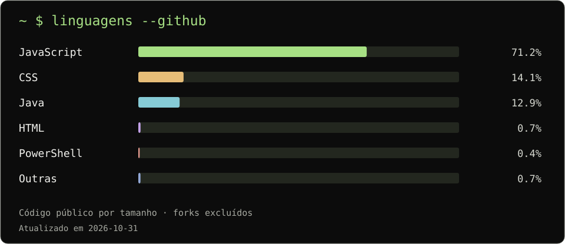

  

# Olá, sou o Carvel

Tenho foco em **desenvolvimento backend com Java** e gosto de entender como as coisas funcionam por trás de uma aplicação: como os dados são organizados, como uma consulta é construída e como uma regra de negócio vira código.

Parte dos meus projetos nasceu de necessidades do meu trabalho. Já desenvolvi ferramentas para formatar pedidos, imprimir comandas, organizar entregas e facilitar o fechamento de caixa. É o tipo de problema que me interessa resolver: algo que faz diferença na rotina de quem usa.

Também uso **JavaScript, React e Node.js** nos meus projetos. No Java, estou aprofundando meus conhecimentos em persistência, JDBC, SQL e testes, principalmente através do **Cdatra**, uma biblioteca que estou construindo para estudar o mapeamento entre objetos e banco de dados.

  <a href="https://github.com/LordCarvel/Cdatra">Projeto em Java</a>
  &nbsp; · &nbsp;
  <a href="https://github.com/LordCarvel?tab=repositories">Todos os projetos</a>
  &nbsp; · &nbsp;
  <a href="https://wakatime.com/@639f7836-87c5-41ed-8dd2-0f0090178640">WakaTime</a>

## Tecnologias e conhecimentos

| Área | O que venho usando nos projetos |
| :--- | :--- |
| **Backend** | Java 17, Node.js e implementação de regras de negócio |
| **Persistência** | JDBC, SQL, H2, SQLite e armazenamento local no navegador |
| **Fundamentos Java** | Orientação a objetos, generics, reflexão e anotações |
| **Web e desktop** | JavaScript, React, HTML, CSS, Vite e Electron |
| **Qualidade** | Testes com JUnit, Maven e análise de cobertura com JaCoCo |
| **Ferramentas** | Git, GitHub, GitHub Actions e Neovim |

## Projetos em destaque

### [Cdatra · persistência em Java](https://github.com/LordCarvel/Cdatra)

Uma biblioteca de aprendizado para reduzir o código repetitivo de acesso a dados com JDBC. A proposta é partir de uma classe anotada e usá-la para criar tabelas, salvar, consultar, atualizar e excluir registros.

- Mapeamento de entidades com **anotações e reflexão**.
- API com `Repository<T>`, filtros e operadores de consulta.
- Validação de metadados, tipos e operações de persistência.
- Testes de integração com **JUnit e H2**, incluindo CRUD, filtros e transações.

É o projeto que melhor representa meu interesse atual em backend. A documentação explica a API, como executar os testes e os limites da versão, com exemplos reproduzíveis.

**Java 17 · JDBC · SQL · H2 · Maven · JUnit · JaCoCo**

### [EasyPrintV2 / Easy Hub · pedidos e impressão](https://github.com/LordCarvel/EasyPrintV2)

Aplicação para trabalhar com pedidos e comandas térmicas em uma operação de alimentação. Reúne configuração de modelos, preparação dos dados para impressão e recursos voltados à rotina de atendimento.

- Interface em **React**, com navegação e configurações de impressão.
- Tratamento de texto de pedidos e personalização de comandas.
- Servidor em **Node.js**, com compartilhamento de pedidos entre computadores.
- Versão desktop com **Electron** e distribuição para Windows.

Esse projeto me permite trabalhar na integração entre interface, dados, impressão e entrega da aplicação.

**JavaScript · React · Node.js · SQLite · Vite · Electron**

### [Delivery-Board-V2 · organização de entregas](https://github.com/LordCarvel/Delivery-Board-V2)

Ferramenta para organizar entregadores e pedidos, agrupar entregas por rodada e editar informações da operação. A segunda versão continua o trabalho do Delivery-Board, com interface web e dados armazenados no navegador.

**JavaScript · React · Vite · localStorage**

### [Finally-Storage · fechamento de caixa](https://github.com/LordCarvel/Finally-Storage)

Aplicação para registrar os totais dos entregadores, separar valores por forma de pagamento e calcular o fechamento diário. Mantém os dados no navegador e concentra informações que precisam ser conferidas no fim do expediente.

**JavaScript · HTML · CSS · localStorage**

## Como trabalho nos projetos

Procuro começar pelo problema e entender o fluxo de quem vai usar a ferramenta. Nos projetos de operação, isso aparece no cuidado com pedidos, impressão e conferência de valores. No Cdatra, o foco é outro: estudar a implementação, testar os comportamentos e documentar o que a biblioteca faz.

Meu próximo passo técnico é continuar aprofundando **Java, banco de dados e testes de backend**, construindo uma base que eu consiga explicar e aplicar em projetos maiores.

## Atividade no GitHub

  

  

Dados atualizados diariamente. Contribuições e commits cobrem os últimos 12 meses; linguagens representam o tamanho do código nos repositórios públicos, incluindo os arquivados, e não o tempo de programação.

<!-- WAKATIME:START -->

## Tempo de programação

  

Tempo registrado pelo WakaTime nos editores conectados. A distribuição de linguagens considera o período indicado no painel.

<!-- WAKATIME:END -->

## Para conhecer meu trabalho

Se você está avaliando meu perfil para uma oportunidade em desenvolvimento, recomendo começar pelo [Cdatra](https://github.com/LordCarvel/Cdatra): a documentação, os exemplos e os testes mostram como estou trabalhando com Java. Para ver uma aplicação com interface, servidor e distribuição desktop, veja o [EasyPrintV2](https://github.com/LordCarvel/EasyPrintV2).

Você encontra o restante do meu código na [lista de repositórios](https://github.com/LordCarvel?tab=repositories).
