<!-- Gerado a partir dos dados públicos. Textos e layout: scripts/render_profile.py. -->

<a href="https://lordcarvel.github.io/LordCarvel/#activity">Explorar atividade por período</a> &nbsp; / &nbsp; <a href="https://github.com/LordCarvel/Cdatra">Conhecer o Cdatra</a> &nbsp; / &nbsp; <a href="https://github.com/LordCarvel?tab=repositories">Todos os projetos</a>



<a href="https://github.com/LordCarvel/Cdatra"></a>

<a href="https://github.com/LordCarvel/EasyPrintV2"></a>

<a href="https://github.com/LordCarvel/Delivery-Board-V2"></a>

<a href="https://github.com/LordCarvel/Finally-Storage"></a>

<a href="https://lordcarvel.github.io/LordCarvel/#activity"></a>

Mês atual · 37 contribuições · 36 commits

<a href="https://lordcarvel.github.io/LordCarvel/?period=mes#activity"></a>

Bimestre atual · 37 contribuições · 36 commits

<a href="https://lordcarvel.github.io/LordCarvel/?period=bimestre#activity"></a>

Semestre atual · 225 contribuições · 220 commits

<a href="https://lordcarvel.github.io/LordCarvel/?period=semestre#activity"></a>

Ano atual · 277 contribuições · 270 commits

<a href="https://lordcarvel.github.io/LordCarvel/?period=ano#activity"></a>

<!-- WAKATIME:START -->

<!-- WAKATIME:END -->

<a href="https://github.com/LordCarvel/Cdatra"></a>

<a href="https://github.com/LordCarvel/Cdatra#readme">Ler a documentação do Cdatra</a> &nbsp; / &nbsp; <a href="https://github.com/LordCarvel/EasyPrintV2">Explorar o Easy Hub</a> &nbsp; / &nbsp; <a href="https://lordcarvel.github.io/LordCarvel/">Ver minha atividade</a>

Dados atualizados a cada 6 horas. Filtros: períodos de calendário em andamento. WakaTime: histórico público completo, independente dos filtros. Linguagens do GitHub: tamanho atual do código público, sem recorte de período.

